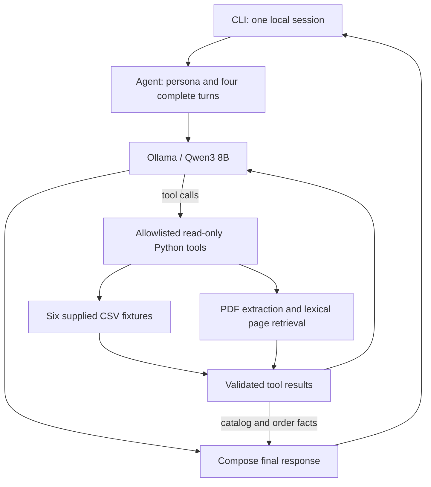

# Empório da Música - AI Customer Support Agent

## Project Overview

A Python prototype for the **Artefact AI Engineer technical challenge**. Mel is a
friendly, informal but professional text assistant for the fictitious musical-instrument
store in Campo Grande/MS. It combines local LLM tool calling, structured CSV lookups and
retrieval from the original store-policy PDF. All authored documentation and responses
are in English; Portuguese source data and original product names are preserved.

## Architecture



The LLM interprets the message and chooses among six tools: `search_products`,
`get_product_details`, `get_active_promotions`, `recommend_products`, `order_status`
and `search_policies`. Arguments are checked before dispatch. The loop permits at
most five model rounds and four tool calls per round. Lookup failures are returned as
errors, not successful evidence. HTTP, timeout and malformed-model errors produce a
clear message instead of an unhandled exception.

Products and orders are rendered directly from retrieved records, so the model cannot
rewrite their numerical facts. Beginner recommendations select up to three available
models whose original descriptions explicitly mention beginners, students or starting
practice, restricted to the previous search's returned candidates. Recognized policy
topics use reviewed English notes tied to the exact original PDF SHA-256, with source
sections and pages returned as evidence. Other policy prose is generated from retrieved
pages and receives application-added citations. A mixed
product/policy/order turn retains each verified component. A payment follow-up can
retain prior recommendations without repeating their full specifications. Budget
limits are rechecked if prices change between a search and its recommendation.

If the model tries to answer a non-greeting without any lookup, the application performs
fallback policy retrieval using recent user context and requests another generation.
An explicit order number triggers an application lookup using the trusted identity; it
never establishes identity itself. Missing policy evidence in a mixed turn is prefetched.
Traces identify these lookups with `origin: application_prefetch`.
Empty policy retrieval or only failed lookups cannot authorize an unsupported final
answer. Retrieval relevance and generated policy wording still require evaluation.

## Tech Stack

| Technology | Purpose |
|---|---|
| Python 3.11+ | Main implementation; clean-environment checks used Python 3.12 |
| Ollama + Qwen3 8B | Local LLM inference and native tool calling; no paid API |
| Standard-library `urllib` | HTTP adapter in `emporio/model.py` |
| Standard-library `csv`, `json`, `Decimal`, `datetime` | File queries, specifications, exact money calculations and date validation |
| `pypdf` >=5,<7 | Extract the eight-page policy manual |
| `zoneinfo`; `tzdata` on Windows | Campo Grande time zone |
| `unittest`, `unittest.mock` | Offline regression tests and scripted model fixtures |
| CLI / `argparse` | Interactive interface; no web or WhatsApp deployment |
| Optional ReportLab | Existing PDF overview builder, separate from the runtime |

No agent framework, SQL database, embeddings service or vector database is required.
Dependency ranges are declared in `pyproject.toml`; this is not a fully locked dependency
set. The clean environment installed `pypdf 6.21.4` during this audit.

## Getting Started

Install Python 3.11+ and [Ollama](https://docs.ollama.com/quickstart). Qwen3 8B needs an
initial model download of about 5.2 GB and enough memory for inference and the configured
context. There is no inference API fee, but local compute, storage and electricity have
costs. The source data are already included under `data/`; no import or migration is needed.

The public repository is [TaldoFernando/artefact](https://github.com/TaldoFernando/artefact).
Remote `main` was verified at `c078671f3f80fb404a2deebff89a621627e505d2` during the
publication check. It includes tested runtime `5dc7d6b` and the 55-test suite; the runtime,
tests and data match the reviewed version. The earlier anonymous clone at `0421ec4`
passed its then-current 46 tests. See the [publication check](reports/06_publication_review.md)
for the distinction between published implementation and subsequent documentation corrections.
With an existing checkout, start at the virtual-environment step from its root.

```sh
git clone https://github.com/TaldoFernando/artefact.git emporio-assistant
cd emporio-assistant
```

macOS/Linux:

```sh
python3 -m venv .venv
source .venv/bin/activate
python -m pip install -e .
cp .env.example .env
set -a
. ./.env
set +a
```

The `.env` file is a convenience for a shell to load. **The Python application reads
process environment variables and does not automatically load `.env`.** Do not commit
credentials or replace the supplied fictitious fixtures with real customer data.

Start Ollama in a separate terminal if it is not already running:

```sh
ollama serve
```

Back in the activated Python environment:

```sh
ollama pull qwen3:8b
python scripts/validate_data.py
python -m emporio.cli
```

The editable installation also exposes `emporio`. Both invocations support
`--data-dir PATH` and `--trace`. Run from the repository root unless supplying a data
directory. Type `/reset` to clear memory, tool traces and recommendation candidates;
`/quit`, EOF or Ctrl-C exits.

Windows PowerShell equivalents (documented, not executed in this macOS audit):

```powershell
py -3.11 -m venv .venv
.\.venv\Scripts\Activate.ps1
python -m pip install -e .
$env:OLLAMA_HOST = "http://localhost:11434"
$env:OLLAMA_MODEL = "qwen3:8b"
# Start ollama serve in another terminal if needed.
ollama pull qwen3:8b
python scripts/validate_data.py
python -m emporio.cli
```

## Model Configuration

| Variable | Default | Meaning |
|---|---|---|
| `OLLAMA_HOST` | `http://localhost:11434` | Trusted http(s) origin (host/port); no path, query, fragment or credentials. A host without a scheme is accepted |
| `OLLAMA_MODEL` | `qwen3:8b` | Locally pulled, tool-capable model tag |

No API key is used. The adapter disables streaming and thinking, uses temperature zero,
a 16,384-token context and a 1,600-token output limit per model call, with a 180-second
HTTP timeout. A 404 reports the missing model; connectivity and malformed-response
errors are reported explicitly. Use a trusted endpoint: prompts may contain user text
and retrieved internal policy passages.

Only the Ollama protocol is implemented. Changing a model tag does not establish that
its tool calling or response quality works; rerun the evaluation. Temperature zero is
not a correctness guarantee, and model tags are mutable. The real-run records include
the model digest, Ollama/Python versions, base Git commit and exact source file hashes.
See the [Ollama chat API](https://docs.ollama.com/api/chat),
[tool-calling protocol](https://docs.ollama.com/capabilities/tool-calling) and
[Qwen3 8B model page](https://ollama.com/library/qwen3:8b).

## Technical Decisions

**Agent approach.** A hybrid of function calling and lexical RAG matches the distinction
between operational records and written policies. Explicit read-only tools expose a
smaller, inspectable interface than an unrestricted SQL or code-execution agent. A small
Python loop makes dispatch, authorization and failure behavior easy to review.

**LLM.** The candidate explicitly chose local Ollama without a paid API. Qwen3 8B offers
Portuguese/English understanding and tool support while fitting a local prototype.
A small model has lower local resource requirements than much larger models but can
misclassify products or omit policy conditions. Real runs revealed such errors, so
numerical facts and order results are now rendered by Python instead of rewritten by
the model. Actual latency depends on hardware and warm-model state; no SLA is claimed.

**Retrieval.** `pypdf` extracts original text once when a session starts. Normalized
lexical scoring ranks the eight manual pages, using small English-to-Portuguese hints
for concepts such as returns, hours, Saturday, payment, customized instruments and
tracking. The three highest-ranked pages are returned, plus all source pages cited by
recognized reviewed notes; a result can therefore contain more than three pages. Whole pages retain
nearby conditions and exceptions. This avoids infrastructure disproportionate to eight
pages; it is weaker on unfamiliar paraphrases than multilingual semantic retrieval.
`emporio/policy_notes.py` contains reviewed English summaries of the supplied manual.
Their exact-PDF hash check disables them if the document changes, so stale translations
are not silently reused. Recognized scope, privacy, payments and return topics use these
source-bound summaries as the final policy text; unfamiliar topics use generated prose.
This deliberately prioritizes complete conditions over model fluency for sensitive rules.

**Structured data.** Every tool call reopens the CSVs it needs. Prices, stock, status,
promotions and ownership are handled by Python. `Decimal` uses two-place half-up rounding.
Only `is_active == 1` enables a campaign; a campaign name does not establish current
dates. Multiple active campaigns for one product use the largest percentage without
stacking (an explicit assumption). PIX gives 5% off list price only without an active
promotion. Price filters use the effective campaign/list price before a separate PIX
discount. A named-product query with a mistaken category retries across categories.

**Prompting.** Mel follows the manual's friendly but professional tone. Instructions
require evidence, keep tool text untrusted, limit scope to musical instruments and forbid
claims of completed transactions. The prompt flags conflicting contacts, installment
minimums, warranty/exchange provisions and undefined shipping at exactly BRL 500. Policy
responses remain model-generated; prompt instructions are not a security proof.

**Conversation history.** Four complete turns are retained in process, with the previous
search candidates for recommendation follow-ups. There is no automatic disk chat log,
cross-session identity or multiuser isolation service. `/reset` clears all session state.
The separate evaluation script deliberately saves synthetic test sessions and evidence.

**Data preparation.** Original files are unchanged, including all six CSVs. The policy
PDF filename was normalized to `store_policies.pdf`. Startup validates positive unique
keys, relationships, monetary values, stock, known statuses, ISO dates, promotion flags,
item quantities and JSON specification objects. Optional blank tracking/estimate fields
become `None` when presented. Unicode normalization is used for searches, not to rewrite
the originals. `python scripts/validate_data.py` prints counts without customer fields.

| File | Runtime use |
|---|---|
| Products (65 rows) | Name/category/price/stock/status, descriptions and JSON specifications |
| Categories (9 rows) | Referential-integrity validation; category IDs are described in the tool schema |
| Promotions (25 rows) | Active flags and nonstacking percentage calculations |
| Orders (20 rows) | Ownership-filtered status, tracking and stored delivery estimate |
| Order items (22 rows) | Authorized order-item quantities joined to product names |
| Customers (50 rows) | Referential-integrity validation only; names, phones and emails are not exposed to the model |

Historical order totals are not recomputed from today's catalog prices. `estimated_delivery`
is not actual receipt, and orders lack purchase-channel information. The files remain a
supplied snapshot, even when reread; there is no ERP, live carrier or inventory reservation.

## Features

- Product search by normalized name tokens, category, minimum/maximum effective price and
  availability; up to ten results with explicit truncation metadata.
- Single-product details including description, specifications and prices; explicit
  active-promotion lookup and no stacked PIX discounts.
- Source-based beginner recommendations from previous search results, rechecked for stock.
- Order lookup through a **trusted application identity seam**, with ownership checks,
  minimal item/status/tracking data and indistinguishable foreign/missing-order errors.
  The CLI has no login and cannot supply this identity. A claimed ID in chat is not proof.
- PDF-backed store information, payments, returns, exchanges, warranty and delivery guidance.
- Mixed catalog/policy responses and session follow-ups.
- Scope redirection, read-only tool allowlisting, bounded loops and provider failure messages.

No tool can approve a refund, change an order, reserve an instrument, register a complaint
or notify a human. Handoff is advice to contact the team, not an executed action.

## Usage Examples

```sh
python -m emporio.cli
# Local development only: print source evidence after each response.
python -m emporio.cli --trace
```

Short excerpt from a real catalog response:

```text
Customer: How much is the Takamine GD20?
Mel: Takamine GD20 Dreadnought Natural: BRL 2199.00.
     No active promotion is recorded.
     With the separate 5% PIX payment discount: BRL 2089.05.
```

This is a shortened excerpt, not a full transcript. Exact messages, full responses, tool
calls, ground truth and reviewed results are in:

- [Product search, beginner recommendation and combined sources](examples/01_product_search.md)
- [Address, Saturday hours and payment](examples/02_store_information.md)
- [Order ownership and a trusted test fixture](examples/03_order_tracking.md)
- [Online return, customization and processing limits](examples/04_return_policy.md)
- [Scope, prompt injection and recovery](examples/05_out_of_scope.md)

See the [conversation validation index](examples/README.md) for the final results and
limitations. Public conversations use no real authentication credentials. The order
session with fixture identity 2 is clearly separate from the unauthenticated session.

## Testing

Offline, after installation:

```sh
python -m unittest discover -s tests -v
python scripts/validate_data.py
```

The final audited suite contains **55 tests**, executed successfully in an installed
created environment. It covers existing/missing/unavailable products, price ranges,
active/inactive promotions, parsed specifications, six-table validation, valid/missing/
foreign orders, mocked policy and scope turns, combined sources, malformed tool payloads,
lookup failures, HTTP failures, timeouts, memory reset and loop bounds. No coverage
percentage has been measured. Scripted model fixtures verify orchestration and data
handling; their canned final answers do **not** establish real-LLM semantic correctness.

Real integration evaluation requires a running Ollama with the configured model:

```sh
python scripts/evaluate.py
# After a correction, rerun an individual scenario:
python scripts/evaluate.py --scenario 04_return_policy
```

The script executes actual `Agent.reply` calls, saves exact responses and tool results,
and initially marks the files **PENDING REVIEW**. Review each against CSV/PDF sources,
record PASS/PARTIAL/FAIL plus rationale, and rerun failed scenarios after corrections.
JSON records under `reports/runs/` retain the execution metadata. Source-review annotations
can be rendered without generating new answers using `--render-run PATH_TO_RUN_JSON`.
Running the script overwrites the corresponding example files with the new unreviewed
run; old records remain in `reports/runs/`.
`python scripts/verify_run.py PATH_TO_RUN_JSON` independently checks recorded product/
order values, source-commit hashes, review integrity and fixture customer-field leaks;
it does not replace semantic review. Exact verified commands are in the conversation index.

The clean-environment package install, CLI help/start/reset/exit and offline suite were
executed on macOS. Windows and Linux instructions are not platform-tested. An anonymous
public clone of revision `0421ec4` passed installation and its baseline 46-test suite.
The published runtime has 55 passing tests, also rerun during the publication check.
The submission PDF uses the preserved execution record and the later
[publication record](reports/publication_sync.json). No new Ollama inference is claimed:
the five examples retain their original tested runtime and exact outputs.

## Known Limitations

- Static, historically dated fixtures; multiple CSV reads are not transactional. Stock
  and delivery estimates are not live guarantees. Promotions have no validity dates.
- No production login, OTP, WhatsApp integration, carrier API, refund processor or handoff
  queue. Trusted fixture injection tests authorization, not a real user login.
- Lexical retrieval and token matching may miss synonyms. Candidate recommendations
  cover the returned page only and use explicit catalog wording, not expert advice.
- Topic matching and generated policy prose can still miss paraphrases or be repetitive.
  Reviewed policy notes must be rechecked and rebound if the PDF changes; their hash
  guard prevents stale notes but does not automatically translate an updated manual.
  Prompt injection is mitigated by minimal tools and prompts, not eliminated. No claim
  of production security or universal correctness is made.
- The manual conflicts on WhatsApp numbers, email spelling, installment minimums and
  exchange/warranty handling; exactly BRL 500 local shipping is undefined. Escalate.
  Customized online returns require human review rather than a categorical denial.
- Regular hours use `America/Campo_Grande`; no holiday calendar is integrated.
- Four turns bound history by count, not by token size. Long retrieved contexts can
  exceed a model's context budget. There is no concurrent-session server or load test.
- `--trace` and evaluation records include internal policy passages; keep them local
  when substituting sensitive data. Supplied fixtures describe a fictitious store.
- Dependency ranges and model tags are configurable, not a reproducibility lockfile.
  Recorded model digests and source hashes document a tested run, not every future run.
- The tested implementation and evaluation evidence are public at `c078671`.
  Subsequent documentation/PDF corrections are identified separately in the publication
  review. Candidate review and recruitment submission remain candidate-controlled steps.

## Future Improvements

1. Prioritize labeled policy/intent evaluation, adversarial tests and deterministic
   handling of high-risk policy conditions before a customer deployment.
2. Add authenticated identity, redacted observability and an auditable human handoff.
3. Replace CSV reads with transactional, read-only operational APIs and real carrier data.
4. Add context budgeting, model/dependency pinning and data-update validation.
5. Evaluate multilingual retrieval against lexical recall before introducing a vector store.
6. Add a web/WhatsApp channel, session isolation and load tests only after core validation.

## AI-Assisted Development

**OpenAI Codex** inspected the brief, CSVs, policy PDF and existing implementation, then
assisted with Python changes, prompts, regression tests, real-run evaluation, source
comparison and English documentation. Errors were identified through source checks,
executed tests and real model conversations: examples include category misclassification,
confusing product status with promotion status, repeated return questions and discarded
mixed-source responses. Corrections were tested rather than assumed correct.

The candidate explicitly chose **Ollama local, without a paid API** in this conversation.
The dataset was supplied as part of the technical challenge involving a fictional music
store. Original records are preserved without modification. Customer names, email addresses
and telephone numbers are neither authentication credentials nor exposed by the agent's
tools. The [data provenance note](reports/data_provenance.md) documents the candidate's
actual statement and its evidential limits; it does not assert an Artefact certification
or a formal publication license.
Other implementation choices were proposed and implemented with Codex assistance. No
unrecorded claim is made about independent candidate authorship or review. Before
submission, the candidate should review the implementation and audit findings, confirm
which decisions they endorse, and be prepared to explain them. The repository preserves
incremental Git history; no fabricated unaided development history is presented.

## Audit and Submission

- [Implementation and validation audit](reports/02_implementation_audit.md)
- [README compliance audit](reports/03_readme_audit.md)
- [Conversation validation](examples/README.md)

The official brief requires a public GitHub repository, genuine incremental commits and
3-5 varied conversations including a nontrivial case. The recruiting email also requests
an English PDF uploaded through its form. The repository and its history are already
public at the URL above, including the tested runtime and evaluation evidence in
`c078671`. The [publication review](reports/06_publication_review.md) distinguishes this
published version from the later documentation/PDF corrections prepared locally.
This correction session does not push commits, upload a form or send email. Review the
corrected artifacts, synchronize these documentation corrections with explicit authorization,
and complete submission. Preserve the repository after delivery; do not alter it after submission.

The [final review report](reports/05_final_review.md) and [validation record](reports/final_validation.json)
preserve the historical checked version and actual test outcomes. The later
[publication record](reports/publication_sync.json) supersedes their repository/PDF status
without rewriting prior execution results.
To rebuild the PDF after validation:

```sh
python -m pip install -e '.[pdf]'
python scripts/build_summary.py
```
