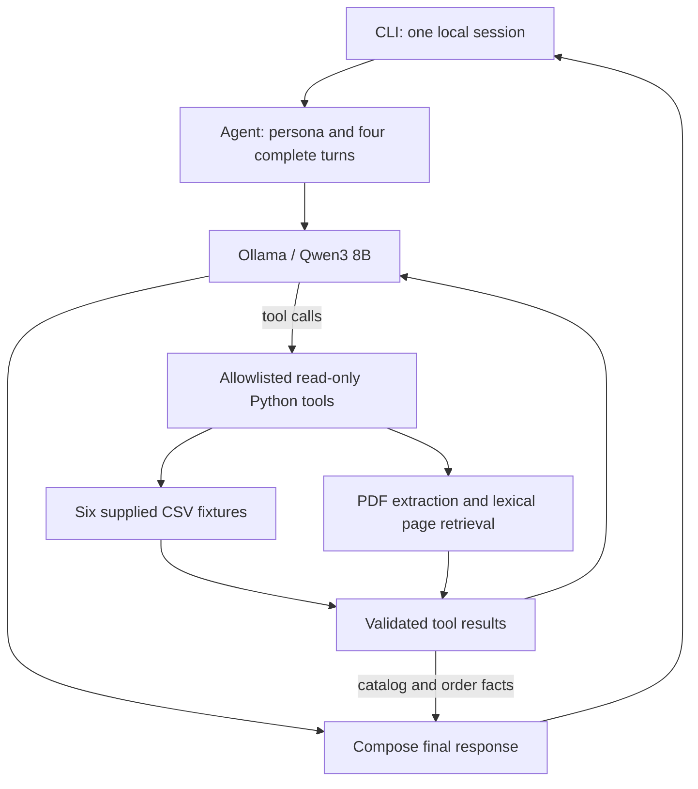

# Empório da Música - AI Customer Support Agent

## Project Overview

A Python prototype for the **Artefact AI Engineer technical challenge**. Mel is a
friendly, informal but professional text assistant for the fictitious musical-instrument
store in Campo Grande/MS. It combines local LLM tool calling, structured CSV lookups and
retrieval from the original store-policy PDF. All authored documentation and responses
are in English; Portuguese source data and original product names are preserved.

## Architecture



The LLM interprets the message and chooses among six tools: `search_products`,
`get_product_details`, `get_active_promotions`, `recommend_products`, `order_status`
and `search_policies`. Arguments are checked before dispatch. The loop permits at
most five model rounds and four tool calls per round. Lookup failures are returned as
errors, not successful evidence. HTTP, timeout and malformed-model errors produce a
clear message instead of an unhandled exception.

Products and orders are rendered directly from retrieved records, so the model cannot
rewrite their numerical facts. Beginner recommendations select up to three available
models whose original descriptions explicitly mention beginners, students or starting
practice, restricted to the previous search's returned candidates. Recognized policy
topics use reviewed English notes tied to the exact original PDF SHA-256, with source
sections and pages returned as evidence. Other policy prose is generated from retrieved
pages and receives application-added citations. A mixed
product/policy/order turn retains each verified component. A payment follow-up can
retain prior recommendations without repeating their full specifications. Budget
limits are rechecked if prices change between a search and its recommendation.

If the model tries to answer a non-greeting without any lookup, the application performs
fallback policy retrieval using recent user context and requests another generation.
An explicit order number triggers an application lookup using the trusted identity; it
never establishes identity itself. Missing policy evidence in a mixed turn is prefetched.
Traces identify these lookups with `origin: application_prefetch`.
Empty policy retrieval or only failed lookups cannot authorize an unsupported final
answer. Retrieval relevance and generated policy wording still require evaluation.

## Tech Stack

| Technology | Purpose |
|---|---|
| Python 3.11+ | Main implementation; clean-environment checks used Python 3.12 |
| Ollama + Qwen3 8B | Local LLM inference and native tool calling; no paid API |
| Standard-library `urllib` | HTTP adapter in `emporio/model.py` |
| Standard-library `csv`, `json`, `Decimal`, `datetime` | File queries, specifications, exact money calculations and date validation |
| `pypdf` >=5,<7 | Extract the eight-page policy manual |
| `zoneinfo`; `tzdata` on Windows | Campo Grande time zone |
| `unittest`, `unittest.mock` | Offline regression tests and scripted model fixtures |
| CLI / `argparse` | Interactive interface; no web or WhatsApp deployment |
| Optional ReportLab | Existing PDF overview builder, separate from the runtime |

Dependencies are declared in `pyproject.toml`. The recorded environment used
Python 3.12.14 and `pypdf 6.21.4`; PDF generation uses the optional `pdf` dependency group.

## Getting Started

Install Python 3.11+ and [Ollama](https://docs.ollama.com/quickstart). Qwen3 8B needs an
initial model download of about 5.2 GB and enough memory for inference and the configured
context. There is no inference API fee, but local compute, storage and electricity have
costs. The source data are already included under `data/`; no import or migration is needed.

The source files are included in the [public repository](https://github.com/TaldoFernando/artefact).
With an existing checkout, start at the virtual-environment step.

```sh
git clone https://github.com/TaldoFernando/artefact.git emporio-assistant
cd emporio-assistant
```

macOS/Linux:

```sh
python3 -m venv .venv
source .venv/bin/activate
python -m pip install -e .
cp .env.example .env
set -a
. ./.env
set +a
```

The `.env` file is a convenience for a shell to load. **The Python application reads
process environment variables and does not automatically load `.env`.** Do not commit
credentials or replace the supplied fictitious fixtures with real customer data.

Start Ollama in a separate terminal if it is not already running:

```sh
ollama serve
```

Back in the activated Python environment:

```sh
ollama pull qwen3:8b
python scripts/validate_data.py
python -m emporio.cli
```

The editable installation also exposes `emporio`. Both invocations support
`--data-dir PATH` and `--trace`. Run from the repository root unless supplying a data
directory. Type `/reset` to clear memory, tool traces and recommendation candidates;
`/quit`, EOF or Ctrl-C exits.

Windows PowerShell equivalents (documented, not executed in this macOS audit):

```powershell
py -3.11 -m venv .venv
.\.venv\Scripts\Activate.ps1
python -m pip install -e .
$env:OLLAMA_HOST = "http://localhost:11434"
$env:OLLAMA_MODEL = "qwen3:8b"
# Start ollama serve in another terminal if needed.
ollama pull qwen3:8b
python scripts/validate_data.py
python -m emporio.cli
```

## Model Configuration

| Variable | Default | Meaning |
|---|---|---|
| `OLLAMA_HOST` | `http://localhost:11434` | Trusted http(s) origin (host/port); no path, query, fragment or credentials. A host without a scheme is accepted |
| `OLLAMA_MODEL` | `qwen3:8b` | Locally pulled, tool-capable model tag |

No API key is used. The adapter disables streaming and thinking, uses temperature zero,
a 16,384-token context and a 1,600-token output limit per model call, with a 180-second
HTTP timeout. A 404 reports the missing model; connectivity and malformed-response
errors are reported explicitly. Use a trusted endpoint: prompts may contain user text
and retrieved internal policy passages.

Only the Ollama protocol is implemented. Evaluate tool calling and responses again
when changing models. Run records include the model digest, Ollama/Python versions,
base Git commit and source hashes.
See the [Ollama chat API](https://docs.ollama.com/api/chat),
[tool-calling protocol](https://docs.ollama.com/capabilities/tool-calling) and
[Qwen3 8B model page](https://ollama.com/library/qwen3:8b).

## Technical Decisions

**Local model.** The candidate chose Ollama without a paid API. Qwen3 8B provides
English/Portuguese interpretation and native tool support for local execution.
Evaluation used a macOS host with 24 GiB RAM; latency depends on hardware and model state.

**Function calling.** Six read-only functions give the model explicit query schemas.
A small Python loop handles dispatch, argument checks and required evidence without
an orchestration framework. Mel's prompt defines the store persona, scope, source use
and transaction boundaries; retrieved text is treated as data.

**Structured queries.** Each call reopens the CSVs it needs. Python handles stock,
status, ownership and prices using `Decimal` with two-place half-up rounding.
Only `is_active == 1` enables a campaign. If several are active, the largest percentage
applies without stacking; this is an implementation assumption. PIX gives 5% off list
price only when no campaign is active. Price filters use campaign/list prices before
PIX. A named-product query with a mistaken category retries across categories.
Historical order totals are not rebuilt from current prices, and an estimated delivery
date is not treated as receipt. Orders do not record purchase channel.

**Policy retrieval.** `pypdf` extracts the eight-page manual at session startup.
Normalized lexical scoring and English-to-Portuguese topic hints return the three
highest-ranked pages. Whole pages retain nearby conditions and exceptions without
an embedding service. Reviewed notes in `emporio/policy_notes.py` add their cited pages,
so a result may contain more than three pages. Their exact-PDF hash check disables
them when the source changes. Recognized scope, privacy, payment and return topics use
these notes; other topics use generated prose from retrieved pages.

**Session state.** Four complete turns and prior search/recommendation context are kept
in memory. `/reset` clears them. The CLI does not save chat logs automatically;
`scripts/evaluate.py` saves test sessions and tool evidence explicitly.

**Data preparation.** All six CSVs and the policy PDF retain their original bytes;
only the PDF filename was normalized to `store_policies.pdf`. Startup validates unique
positive keys, relationships, monetary values, stock, statuses, ISO dates, promotion
flags, quantities and JSON specification objects. Blank tracking/estimate fields become
`None`. Search normalization does not rewrite source files.

| File | Runtime use |
|---|---|
| Products (65 rows) | Name/category/price/stock/status, descriptions and JSON specifications |
| Categories (9 rows) | Referential integrity and category IDs in tool schemas |
| Promotions (25 rows) | Active flags and nonstacking percentage calculations |
| Orders (20 rows) | Ownership-filtered status, tracking and stored delivery estimate |
| Order items (22 rows) | Authorized item quantities joined to product names |
| Customers (50 rows) | Referential integrity only; names, phones and emails are not exposed to the model |

## Features

- Product search by normalized name tokens, category, minimum/maximum effective price and
  availability; up to ten results with explicit truncation metadata.
- Single-product details including description, specifications and prices; explicit
  active-promotion lookup and no stacked PIX discounts.
- Source-based beginner recommendations from previous search results, rechecked for stock.
- Order lookup through a **trusted application identity seam**, with ownership checks,
  minimal item/status/tracking data and indistinguishable foreign/missing-order errors.
  The CLI has no login and cannot supply this identity. A claimed ID in chat is not proof.
- PDF-backed store information, payments, returns, exchanges, warranty and delivery guidance.
- Mixed catalog/policy responses and session follow-ups.
- Scope redirection, read-only tool allowlisting, bounded loops and provider failure messages.

No tool can approve a refund, change an order, reserve an instrument, register a complaint
or notify a human. Handoff is advice to contact the team, not an executed action.

## Usage Examples

```sh
python -m emporio.cli
# Local development only: print source evidence after each response.
python -m emporio.cli --trace
```

Short excerpt from a real catalog response:

```text
Customer: How much is the Takamine GD20?
Mel: Takamine GD20 Dreadnought Natural: BRL 2199.00.
     No active promotion is recorded.
     With the separate 5% PIX payment discount: BRL 2089.05.
```

This is a shortened excerpt, not a full transcript. Exact messages, full responses, tool
calls, ground truth and reviewed results are in:

- [Product search, beginner recommendation and combined sources](examples/01_product_search.md)
- [Address, Saturday hours and payment](examples/02_store_information.md)
- [Order ownership and a trusted test fixture](examples/03_order_tracking.md)
- [Online return, customization and processing limits](examples/04_return_policy.md)
- [Scope, prompt injection and recovery](examples/05_out_of_scope.md)

See the [conversation validation index](examples/README.md) for the final results and
limitations. Public conversations use no real authentication credentials. The order
session with fixture identity 2 is clearly separate from the unauthenticated session.

## Testing

Run the offline checks after installation:

```sh
python -m pip check
python -m unittest discover -s tests -v
python scripts/validate_data.py
python -m compileall -q emporio scripts tests
```

The recorded suite passed **55 tests, with zero failures**, on Python 3.12.14 / macOS.
It covers catalog filters, prices/promotions/PIX, specifications, six-table validation,
order ownership, mixed responses, follow-ups, malformed tool calls, lookup/provider
failures, reset and loop bounds. Scripted model fixtures check orchestration and data
handling. No coverage percentage was measured.

Real-model evaluation requires Ollama and the configured model:

```sh
python scripts/evaluate.py
# Rerun one scenario after a correction:
python scripts/evaluate.py --scenario 04_return_policy
```

The five reviewed conversations contain **20 actual turns** on runtime `5dc7d6b`, with
five PASS outcomes against their documented source/behavior criteria. This is separate
from the offline suite. See the [conversation index](examples/README.md) for transcripts,
model metadata, earlier failures and reproduction commands.

The evaluator saves exact responses/tool results in `reports/runs/` and initially marks
examples **PENDING REVIEW**. Review them against the CSV/PDF sources and record a result
and rationale. A new run overwrites the corresponding example files; old JSON records
remain. Annotations can be rendered with `--render-run PATH_TO_RUN_JSON` without inference.

```sh
python scripts/verify_run.py reports/runs/20261102T023230Z.json
```

This verifier checks product/order values, source hashes, review integrity and fixture
customer-field disclosure. It does not grade policy meaning or generalize scenario
results to arbitrary prompts. Installation, CLI help/start/reset/exit and dependency
checks were also exercised on macOS; historical logs are linked in the audit reports.

## Known Limitations

- **Data and business rules:** fixtures are historical snapshots, CSV reads are not
  transactional, promotions lack validity dates, and delivery estimates are not live
  guarantees. The manual conflicts on contacts, installment minimums and exchange/warranty
  rules; shipping at exactly BRL 500 is undefined. Customized online returns need staff
  review. Regular hours use `America/Campo_Grande` without a holiday calendar.
- **Language and retrieval:** lexical search can miss synonyms and policy paraphrases.
  Recommendations cover the returned search page and require explicit source wording
  about beginners. Generated policy prose may be incomplete or repetitive. Changed PDFs
  require review and rebinding of the English policy notes.
- **Access and actions:** the CLI has no login, OTP, WhatsApp channel, live ERP/carrier
  integration, transaction processor or operational handoff. A trusted order fixture tests
  ownership filtering, not production authentication. `--trace` and evaluation logs include
  internal policy text; restrict them when using sensitive data. Prompt injection remains
  a risk despite tool restrictions and evidence checks.
- **Runtime and reproducibility:** four-turn memory does not bound token size. There is
  no multiuser server, session-isolation service or load test. Model tags and dependency
  ranges are not pinned. Windows/Linux instructions are documented but were not executed;
  recorded checks used macOS.

## Future Improvements

1. Prioritize labeled policy/intent evaluation, adversarial tests and deterministic
   handling of high-risk policy conditions before a customer deployment.
2. Add authenticated identity, redacted observability and an auditable human handoff.
3. Replace CSV reads with transactional, read-only operational APIs and real carrier data.
4. Add context budgeting, model/dependency pinning and data-update validation.
5. Evaluate multilingual retrieval against lexical recall before introducing a vector store.
6. Add a web/WhatsApp channel, session isolation and load tests only after core validation.

## AI-Assisted Development

**OpenAI Codex** assisted with source inspection, implementation, prompts, regression
tests, actual model runs, source comparison and English documentation. Checks exposed
category/promotion mistakes, incomplete return conditions and discarded mixed-source
answers; corrections were checked with tests and recorded conversations.

The candidate explicitly chose **local Ollama without a paid API**. Other design and
implementation work received Codex assistance. Candidate review and endorsement are
not assumed: the candidate is responsible for reviewing the code, results and decisions
before submission and being able to explain them.

The supplied dataset describes a fictional music store. The
[data provenance note](reports/data_provenance.md) records the candidate's actual
statement and its limits. Original records and incremental Git history are preserved.

## Audit and Submission

- [Implementation findings](reports/02_implementation_audit.md)
- [README checks](reports/03_readme_audit.md)
- [Conversation results and failure history](reports/04_conversation_audit.md)
- [Final technical review](reports/05_final_review.md)
- [Publication checks and latest editorial validation](reports/06_publication_review.md)

Runtime `5dc7d6b` is the source version behind the 55-test suite and five real-model
examples. Remote `main` was observed at `7882555` during this editorial review; it
contains that runtime and the earlier documentation corrections. The immutable
[execution record](reports/final_validation.json) and
[publication snapshot](reports/publication_sync.json) describe their respective checks,
including the PDF versions that existed then.

The brief requests a public repository, incremental history and 3-5 conversations;
the recruiting email also requests an English PDF. Review and publish the editorial
changes before uploading the PDF/link. No push or recruitment submission is performed
by this review. Keep the repository unchanged after submission.

To rebuild the submission PDF:

```sh
python -m pip install -e '.[pdf]'
python scripts/build_summary.py
```
